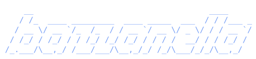
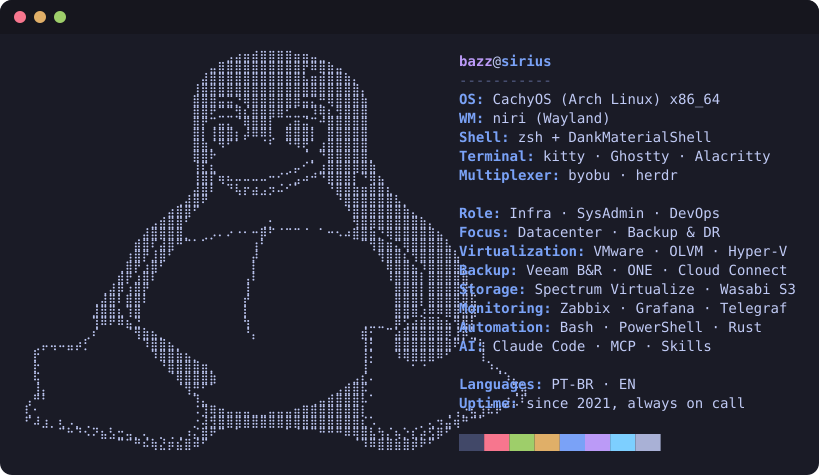

<!-- Profile README for github.com/l-bazzanella -->

<p align="center">
  
</p>

<p align="center">
  
</p>

<p align="center">
  
</p>

```console
bazzanella:~$ whoami
Infrastructure engineer. I run datacenters, virtualization and backup for
companies that need them to just work, then automate whatever I touch twice.

bazzanella:~$ cat now.txt
  - building Claude Code skills and plugins for real ops work
  - tightening monitoring: fewer alerts, better ones
  - turning runbooks into scripts
```

### PT-BR

```console
bazzanella:~$ whoami --lang pt-br
Engenheiro de infraestrutura. Cuido de datacenter, virtualização e backup
para empresas que precisam que tudo funcione, e automatizo o que faço mais
de uma vez.

bazzanella:~$ cat foco.txt
  infra      virtualização, storage, backup e DR entre dois datacenters
  sysadmin   Windows Server e Linux, AD, GPO, SSH, a triagem do dia a dia
  devops     script no lugar de clique, config no git, alerta que tem motivo
  ia         agentes, skills e plugins do Claude Code dentro da operação
```

```console
bazzanella:~$ uptime
 up since 2021 · always on call · coffee: high
```

<!--
  Optional extras, uncomment when you want them:

  
  
-->
